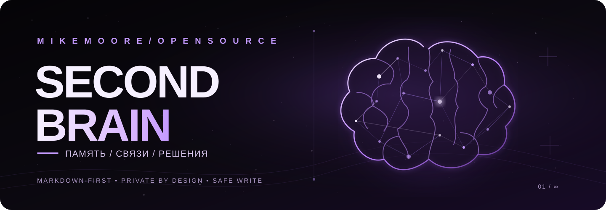
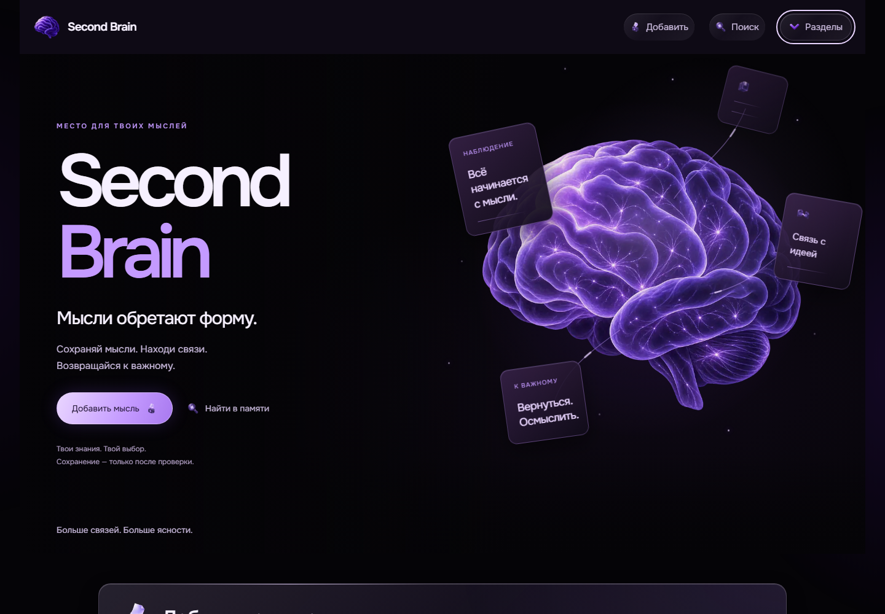
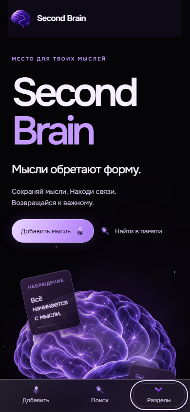
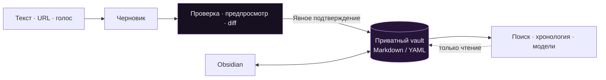

<div align="center">



<h1 align="center">Second Brain</h1>

**Личная система знаний, в которой данные принадлежат вам.**  
Собирайте материалы, связывайте наблюдения с решениями и возвращайтесь к важному - с проверкой каждого изменения перед сохранением.

[](https://github.com/MikeMoore1337/second-brain/actions/workflows/ci.yml) &nbsp;  &nbsp;  &nbsp; [](LICENSE)

[**Возможности**](#возможности) · [**Быстрый старт**](#быстрый-старт) · [**Архитектура**](#архитектура-в-одной-схеме) · [**Интерфейс**](#интерфейс) · [**Документация**](#документация)

</div>

---

## Идея

**Second Brain** - открытое приложение для управления личными знаниями на основе Markdown и YAML. Оно помогает превратить разрозненные заметки, источники и решения в систему, которую можно проверять, развивать и переносить между инструментами.

Главный принцип: **файлы приватного vault - источник истины**. Obsidian - удобный, но необязательный клиент. Поиск, хронология и производные модели не заменяют оригинальные записи.

## Возможности

| | Возможность | Что даёт |
| :---: | --- | --- |
| ✦ | **Сбор информации** | Черновики из текста и ссылок, голосовой ввод с отдельной расшифровкой и последующей проверкой. |
| ◇ | **Безопасное сохранение** | Предпросмотр Markdown, полный diff, dry-run и явное подтверждение перед записью. |
| ⌕ | **Поиск и возвращение к знаниям** | Поиск по управляемым заметкам, открытие актуального содержимого из vault; индекс остаётся производным. |
| ◈ | **Когнитивная модель** | Личная память, журнал решений, временная шкала и другие проверяемые проекции, отделённые от исходных фактов. |
| ⟡ | **Открытый формат** | Markdown/YAML, совместимость с Obsidian, отдельный приватный vault и независимость ядра от конкретного интерфейса. |

> [!IMPORTANT]
> **Память - не автоматическая истина.** Черновик, вывод модели и результат поиска не становятся достоверной записью без отдельной проверки и разрешённого сохранения.

## Интерфейс

<div align="center">
  <a href="docs/design/evidence/186-v7/header-1440.png"></a>
  <a href="docs/design/evidence/186-v7/header-390.png"></a>
</div>

<sub>Снимки из проверки дизайна на синтетических данных. Публичный production-интерфейс предназначен для авторизованного владельца: открытого демодоступа нет.</sub>

## Архитектура в одной схеме



- **`second-brain` (этот репозиторий)** - приложение, API, интерфейс, тесты, контракты и документация.
- **`second-brain-vault` (отдельный приватный репозиторий)** - пользовательские заметки и вложения. Это не submodule, не часть публичного дистрибутива и не место для секретов.
- **Производные представления** - пересоздаваемые read-only данные, а не дополнительный источник истины.

Детали: [обзор архитектуры](docs/architecture/overview.md) · [контракт vault](docs/architecture/vault-contract-v1.md) · [план когнитивной модели](docs/cognitive-twin/design-roadmap-v1.md).

## Быстрый старт

**Необходимо:** Python 3.14, [uv](https://docs.astral.sh/uv/) и, для веб-интерфейса, Node.js 24 + npm.

В PowerShell из каталога проекта:

```powershell
uv sync --locked
Copy-Item .env.example .env
uv run second-brain --env-file .env doctor
uv run second-brain --env-file .env vault validate
```

Создайте **свой** vault по [контракту](docs/architecture/vault-contract-v1.md), разместите его рядом с каталогом приложения или задайте путь явно в `.env`. Приватный vault владельца проекта не требуется и не распространяется. Обе команды выше выполняют проверку без изменения файлов.

На macOS/Linux вместо `Copy-Item .env.example .env` используйте `cp .env.example .env`.

Для локального веб-интерфейса сначала соберите фронтенд:

```powershell
cd web
npm ci
npm run check
npm run build
cd ..
uv run second-brain web serve
```

Откройте **http://127.0.0.1:8123**. Локальная оболочка доступна без запуска Obsidian; операции с vault используют явную конфигурацию и предусмотренные проверки. Подключение внешних сервисов для соответствующих функций настраивается отдельно.

## Документация

| Раздел | Материалы |
| --- | --- |
| Устройство проекта | [Архитектура](docs/architecture/overview.md) · [Контракт хранилища](docs/architecture/vault-contract-v1.md) |
| Развитие и возможности | [Cognitive Twin roadmap](docs/cognitive-twin/design-roadmap-v1.md) · [PRODUCT.md](PRODUCT.md) |
| Интерфейс и стиль | [DESIGN.md](DESIGN.md) · [Проверки дизайна](design-qa.md) · [Web PWA](docs/web-pwa.md) |
| Разработка и качество | [Участие в проекте](CONTRIBUTING.md) · [AGENTS.md](AGENTS.md) · [Набор ролей и агентов](ai/README.md) · [CI](.github/workflows/ci.yml) |
| Развёртывание и безопасность | [Web production](docs/deployment/web-production.md) · [GitHub OAuth](docs/deployment/web-auth.md) · [Vault Sync](docs/deployment/vault-sync.md) · [Security Policy](SECURITY.md) |

Дополнительно: [технический справочник](docs/TECHNICAL_REFERENCE.md) · [поддержка](SUPPORT.md) · [правила сообщества](CODE_OF_CONDUCT.md).

## Безопасность и лицензия

Проект не включает личные записи, токены, вложения vault или production-конфигурацию. Локальные команды чтения не обращаются к LLM или сети; сетевые операции и запись требуют отдельных разрешённых действий. **Ни один публичный пример не должен содержать реальные пользовательские знания.**

Исходный код доступен на условиях [Apache License 2.0](LICENSE). Условия сторонних ресурсов сохранены в [уведомлениях](third_party/licenses/) и [лицензиях оформления](docs/design/licenses/).

---
